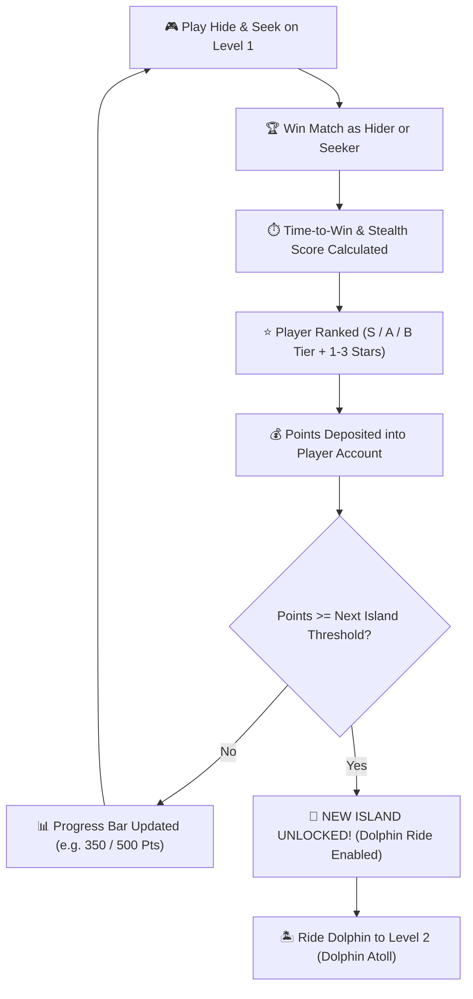

# Lukao 3D — Island Levels, Points & Progression System Architecture

> **Feature Goal:** Transform the archipelago islands into **progressive game levels** unlocked by winning matches, earning score points, and ranking players based on their speed and stealth mastery.  
> **Document Location:** `docs/island-levels-and-progression-plan.md`  
> **Platform Target:** Cross-Platform (iOS / Android Hermes in Expo Go & WebGL).

---

## 1. Overview & Core Gameplay Loop

In **Lukao**, each island in the ocean represents a distinct **Level & Biome**. Players begin on the starter island (**Level 1: Shonali Gram**) and must earn **Lukao Points (লুকো পয়েন্ট)** by winning matches to unlock ocean passage to subsequent islands.



---

## 2. Archipelago Level Roster & Unlock Requirements

| Level | Island Name | Points Required | Difficulty | Key Landmarks & Playgrounds | Level Reward |
| :---: | :--- | :---: | :---: | :--- | :--- |
| **01** | **Shonali Gram (সোনালী গ্রাম)**<br>*(The Homeland)* | **0 Pts**<br>*(Unlocked)* | Normal | • Corrugated Tin Homestead & Veranda<br>• Mud plinth & climbing straw bales<br>• Golden Haystack concealment<br>• Grazing cow, tubewell, roaming chickens<br>• East Meadow shaded Mango Tree & brick chatal | Starter Village Scout Badge |
| **02** | **Ice Age Atoll (হিমেল দ্বীপ)**<br>*(Glacial Spire)* | **500 Pts** | Intermediate | • Expansive 32m prehistoric island with 110-particle snowfall<br>• **Frost Citadel Castle (14m x 12m)** with **100% Woody Interior & Zero Ice**<br>• **Animated Ice Age Wildlife Kingdom (`ice-age-animals.tsx`):**<br>  - **Penguin Colony:** Pip the fisherman waddling & catching silver fish, Pudge belly-sliding across slick ice into the lagoon, and Percy the lookout flapping wings.<br>  - **Frantic Saber-Toothed Squirrel Scrat:** Frantically scampering, sniffing, ramming a giant glowing golden acorn into ice, and panicking when approached.<br>  - **Living Woolly Mammoth Manny:** Majestic shaggy mammoth strolling across tundra, grazing frost shrubs with articulated curling trunk, and trumpet greeting.<br>  - **Prowling Saber-Toothed Tiger Diego:** Stalking outside the ice cavern with long curved dagger fangs.<br>  - **Lounging Ground Sloth Sid:** Relaxing back on snowdrift, scratching belly with curved claws, and waving.<br>• Polished dark oak timber floors, wainscoting wood panels, heavy dark oak rafter beams<br>• Stone & timber fireplace with roaring warm logs & amber embers in Banquet Hall<br>• **Interior Camera Rig:** Dynamically closes to 2.2m distance, eye-level pitch, ceiling/wall clamped<br>• Interactive hiding: **Walk-In Almira** (with coats rail), under banquet table crawlspace, wardrobe drawers bureau, secret library bookshelf, treasury gold chest<br>• Secret walk-in cave *behind* dual-tier glacial waterfall (Northwest)<br>• Giant Woolly Mammoth skeleton & 5-rib walk-through tunnel<br>• Deep Glacial Crevasse with ice bridge & escape underpass<br>• Fast Ice Slide chute descending from Northwest summit ridge to snow plateau<br>• Camouflaged Snowmen Decoy Grove & Sabertooth Cavern | 350 Coins + Glacial Explorer Title |
| **03** | **Al-Dahna Desert Oasis (মরুভূমি ও পিরামিড)**<br>*(Pharaoh's Sands)* | **1,200 Pts** | Hard | • **High-Altitude Hot Air Balloon Aerial Transport:** Flights between Alpine Balloon Pier [68.5, 0.45, 78.5] and Desert Oasis Pier [-68.5, 0.45, 78.5] cruising at y=22m through billowy clouds (dual stations for round-trips)<br>• Expansive 32m golden sand dune desert with heat shimmer & sand drift<br>• **The Grand Pharaoh's Citadel Palace (26m x 26m, 556m² completely enclosed interior):** Solid double-sided sandstone walls and solid ceiling slab completely eliminating outer world visual clipping, featuring 7 rooms:<br>  - **Room 1: Grand Central Hypostyle Hall:** 6 Lotus stone columns, 3.8m Pharaoh feast banquet table (crawlspace underneath), Golden Sun Throne, and 4 fire braziers.<br>  - **Room 2: Royal Bedchamber:** **Egyptian Walk-In Almira** (with hanging robes to hide inside), Royal Canopy Daybed (crawl underneath), and privacy screen.<br>  - **Room 3: Royal Treasury & Gold Vault:** Open gilded treasure chest (hide inside/behind), amphora clusters, and gold ingot stacks.<br>  - **Room 4: Scribe Archives:** Scroll bookshelves (hide behind) and scribe writing desk.<br>  - **Room 5: Palace Armory & Guard Hall:** Khopesh sword/spear racks and bronze shields.<br>  - **Room 6: Arcane Astronomy & Star Chamber:** Celestial star globe and privacy screen.<br>  - **Room 7: North Secret Bypass Corridor:** Full 22m concealed back-corridor for escape loops.<br>  - **Hider Escape Routes & Sliding Doors:** North Balcony Terrace onto dunes, West Oasis Escape Shaft, and 7 proximity-triggered sliding stone doors.<br>• **Oasis Watering Hole:** Freshwater spring with **Drinking Arabian Horses** and feathery papyrus reeds<br>• **Animated Camels:** Standing & chewing cud with caravan saddlebags, resting camel shifting neck<br>• **Slithering Desert Snakes:** Sinusoidal wave locomotion across sand dunes and sunning rocks<br>• **Soaring Desert Eagles:** Circling high in thermals, tracking characters below and swooping down<br>• **Desert Joshua Trees ("judge trees") & Date Palms** with ripe golden dates | 700 Coins + Pharaoh's Scarab Trophy |
| **04** | **Mayabi Hill Tracts (মায়াবী পাহাড়ী উপত্যকা)**<br>*(Paradise & Horror Peaks)* | **2,000 Pts** | Very Hard | • **Oceanic Dolphin Transport (Route 2):** Dolphin travels from Level 3 Desert South Pier [-61.0, 0, 43.0] to Level 4 Rivermouth Pier [-60.0, 0, -42.0]<br>• High mountainous hill tracks ($y = 0\text{m} - 14.5\text{m}$) with lush greenery, crags, and lookout summits<br>• Deep mountain river gorge with winding turquoise water<br>• Gushing cascading waterfalls tumbling from high cliffs into river plunge pools<br>• Walkable 18m wooden rope suspension bridge & arched timber bridges<br>• **Horror & Monsoon Climate:** Dark rain clouds, streaming rain droplets, water ripples, low mountain mist<br>• **Dynamic Day-Night Cycle:** Periodic transition into eerie mystical night with glowing crescent moon, hanging rope lanterns, and 45 emissive fireflies (জোনাকি পোকা)<br>• **Winged Celestial Maidens ("Hoors"):** Ethereal figures with fluttering translucent wings, glowing halos, and flowing silk robes strolling the hills<br>• **Expansive Tall Grass Fields (Pampas / কাশফুল):** Dense tall grass groves along riverbanks and slopes offering instant `"HIDDEN"` stealth escape | 1,200 Coins + Celestial Wing Badge |
| **05** | **Stormy Lighthouse (ঝড়ো বাতিঘর দ্বীপ)**<br>*(Apex Spire)* | **5,000 Pts** | Master | • 15-meter climbable stone lighthouse tower<br>• Rotating searchlight beam sweeping island<br>• Crashing ocean spray & thunder atmosphere | 2,500 Coins + Legend of Lukao Trophy |

---

## 3. Points & Ranking Calculation Formula

Points are awarded dynamically at the end of each round based on **Role**, **Outcome**, and **Time Taken to Win (Speed Ranking)**:

### 3.1. Seeker Scoring Formula (Hunt Speed Rating)
Seekers are ranked on how quickly they can track down and tag all 3 Hiders:

$$\text{Total Points} = \text{Base Win} + \text{Speed Bonus} + \text{Remaining Time Multiplier}$$

- **Base Seeker Victory:** $+200 \text{ Pts}$
- **Speed Rank Tiers (Time to Tag All Hiders):**
  - 🏆 **S-Rank (Under 30 Seconds):** $+300 \text{ Bonus Pts}$ (3 Stars ⭐⭐⭐)
  - 🥈 **A-Rank (31 to 50 Seconds):** $+150 \text{ Bonus Pts}$ (2 Stars ⭐⭐)
  - 🥉 **B-Rank (Over 50 Seconds):** $+50 \text{ Bonus Pts}$ (1 Star ⭐)
- **Defeat (Time Ran Out):** $+30 \text{ Consolation Pts}$ (Encourages continued play)

### 3.2. Hider Scoring Formula (Stealth Mastery Rating)
Hiders are ranked on their ability to stay concealed from the Seeker's scanner:

$$\text{Total Points} = \text{Survival Win} + \text{Stealth Time Bonus} + \text{Ghost Multiplier}$$

- **Base Survival Victory:** $+200 \text{ Pts}$
- **Stealth Quality Multipliers:**
  - 👻 **Ghost Run (0 seconds exposed to Seeker):** $+250 \text{ Bonus Pts}$ (3 Stars ⭐⭐⭐)
  - 🌿 **Shadow Runner (< 10 seconds exposed):** $+120 \text{ Bonus Pts}$ (2 Stars ⭐⭐)
  - 🏃 **Scrambler (> 10 seconds exposed):** $+50 \text{ Bonus Pts}$ (1 Star ⭐)
- **Tagged / Caught Out:** $+25 \text{ Consolation Pts}$ + Points per second survived.

---

## 4. UI / UX Design & Interaction Specifications

### 4.1. The Dolphin Pier Gatekeeper Prompt
When the player approaches the South Beach Pier:
- **If Level 2 is LOCKED (< 500 Pts):**
  - **HUD Banner:** 🔒 `LEVEL 2: DOLPHIN ATOLL LOCKED (পয়েন্ট প্রয়োজন: 500)`
  - **Progress Bar:** `350 / 500 Points [███████░░░] (150 Pts to Unlock!)`
  - Pressing `[E]` or tapping prompt triggers the **Island Unlock Card Modal** explaining how many points remain.
- **If Level 2 is UNLOCKED (>= 500 Pts):**
  - **HUD Banner:** 🐬 `LEVEL 2 UNLOCKED! PRESS [E] TO RIDE DOLPHIN (নতুন দ্বীপে চলো!)`
  - Dolphin leaps and oceanic ride engage normally!

### 4.2. Post-Match Victory & Ranking Card Modal
Upon match completion (`phase === 'game_over'`), a modal pops up:
1. **Match Result Banner:** `VICTORY!` or `HUNTER S-RANK!`
2. **Performance Metrics:**
   - ⏱️ **Time to Win:** `00:27s` (Lightning Fast!)
   - 👁️ **Stealth / Tag Rating:** `S-Tier (⭐⭐⭐)`
   - 💰 **Points Earned:** `+450 Pts`
3. **Archipelago Progression Bar:**
   - Visual bar animating from `350` to `500 Pts`.
   - If threshold reached: Festive celebration banner: **🎉 DOLPHIN ATOLL UNLOCKED!**

---

## 5. Technical Implementation Architecture

### 5.1. State Management (`src/components/game/game-state.ts`)
Add persistent player profile fields:

```ts
export interface PlayerProgression {
  totalPoints: number;
  highestRank: 'Bronze' | 'Silver' | 'Gold' | 'Diamond';
  unlockedIslands: string[]; // ['island-1', 'island-2', ...]
  bestTimes: { [missionOrRole: string]: number }; // In seconds
}

export interface IslandLevel {
  id: string;
  number: string;
  name: string;
  nameBn: string;
  requiredPoints: number;
  coordinates: [number, number, number];
  radius: number;
  unlocked: boolean;
  bestTime?: number;
}
```

### 5.2. Persistent Storage (AsyncStorage / Web LocalStorage)
- Save `totalPoints` and `unlockedIslands` locally using `localStorage` on Web and `AsyncStorage` on native mobile.
- Zero server dependency required for singleplayer/offline play; seamlessly syncable to backend rooms when multiplayer arrives.

### 5.3. Gatekeeper Integration in `dolphin-system.tsx`
Check points threshold before allowing `startDolphinRide()`:
```ts
const nextIslandPoints = 500;
const hasUnlockedAtoll = playerProfile.totalPoints >= nextIslandPoints;

if (!hasUnlockedAtoll && dolphinRide.currentLocation === 'home') {
  dolphinRide.promptText = `🔒 DOLPHIN ATOLL LOCKED (${playerProfile.totalPoints} / 500 PTS)`;
  dolphinRide.canRide = false;
}
```

---

## 6. Implementation Milestones

- [x] **Milestone 1: Progression State & Points Engine (Completed)**
  - Add `totalPoints`, `unlockedIslands`, and `matchStats` to `LukaoStore`.
  - Add points calculation algorithms for Hider and Seeker wins based on elapsed time and stealth exposure.
  - Implement persistent storage adapter (`progression-storage.ts`) supporting Web and mobile memory cache.
  - Gate Level 2 (Dolphin Atoll) at 500 Pts in `dolphin-system.tsx` and `game-engine-state.ts`.
  - Verified with 0 TypeScript compilation errors and verified test runs.
- [ ] **Milestone 2: Match Summary & Star Ranking UI**
  - Create interactive victory modal displaying time spent, star rank, points gained, and island unlock meter.
- [ ] **Milestone 3: Pier Gatekeeper & Lock Prompts**
  - Connect Dolphin Pier prompt to player unlock status with animated progress bar on HUD.
- [ ] **Milestone 4: Archipelago Level Map Modal**
  - Add clickable World Map dialog showing all 5 islands, their themes, points required, and current unlock badges.

---

*This document is the official architecture plan for island-based level progression in Lukao, located at `docs/island-levels-and-progression-plan.md`.*

