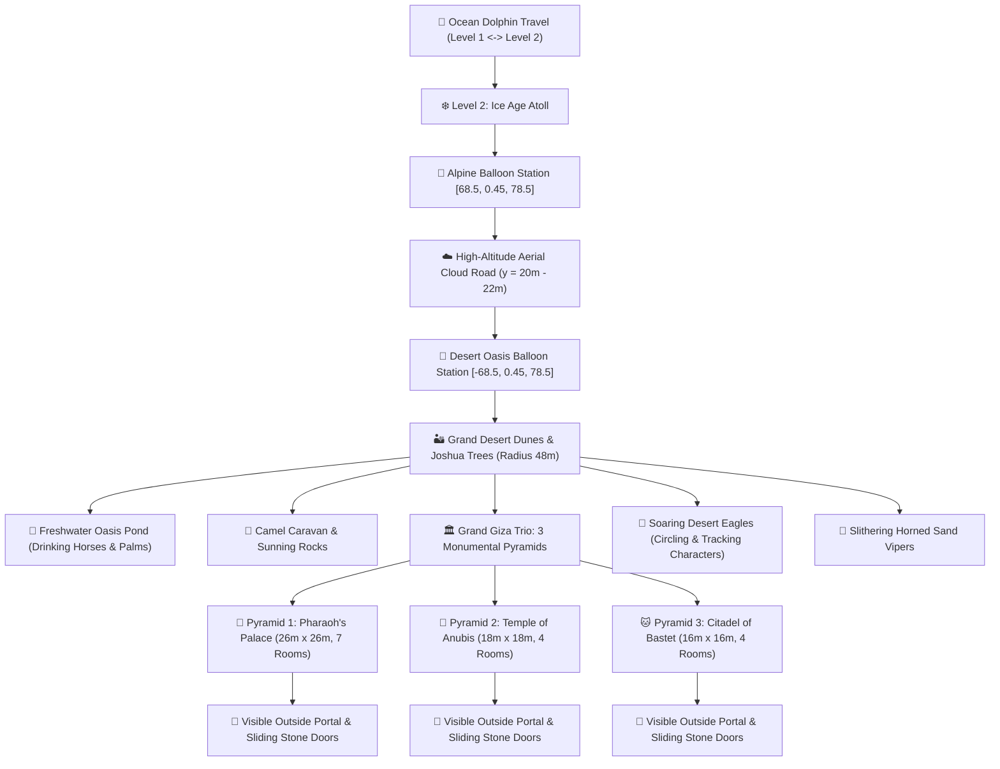

# Level 3: Desert World & Pyramids Empire (মরুভূমি ও পিরামিড সাম্রাজ্য) — Technical Plan & Architecture

> **Feature Goal:** Design and build **Level 3 (Al-Dahna Desert Oasis & Grand Pyramids)** in the Lukao 3D archipelago. Features enterable Egyptian pyramids with interactive opening/closing stone doors, secret escape passages, royal sarcophagus furniture, oasis watering hole with drinking horses, animated camels, slithering desert snakes, Joshua trees, and soaring eagles tracking players from the sky.  
> **Document Location:** `docs/level-3-desert-world-plan.md`  
> **Platform Target:** Cross-Platform (iOS / Android Hermes in Expo Go & WebGL).

---

## 1. Overview & Map Geography

Level 3 is situated in the **South-Western ocean quadrant** centered at **`[-85, 0, 75]`** with a massively expanded **48m radius** footprint (Reef ~50m, Shoreline ~46m, Terracotta tier ~43m, and Golden Sand Plateau ~40m). The landscape features the **Grand Giza Trio of 3 Pyramids**, rolling sand dune ridges, a turquoise freshwater oasis with drinking horses, animated camels, desert snakes, Joshua trees, and soaring eagles.

---

## 2. Landmarks & Interactive Features

### 2.1. Visible Exterior Entrance Portals (Solves Door Invisibility Bug)
All 3 pyramids feature **ceremonial open exterior portals** visible immediately upon approaching from outside:
- **Base Stepped Tier Cutouts:** The base sandstone box tier features dedicated left and right wall blocks with an open central doorway cutout rather than an opaque solid face.
- **Flanking Monumental Pylon Towers:** Massive sandstone pylons framing each entrance portal with golden relief friezes.
- **Raised Ramp Way:** Sandstone walkway leading smoothly up into the entrance portal.
- **Blazing Ceremonial Fire Braziers:** Vibrant flames flanking each entrance to guide players directly to the doors from afar.
- **Proximity Sliding Stone Slab Door:** Clearly visible inside the portal recess; slides smoothly open as the player walks up.

### 2.2. The Grand Giza Trio: 3 Monumental Pyramids with Distinct Themes & Rooms

#### A. Pyramid 1: The Great Pharaoh's Citadel Palace (Center `[-85.0, 78.5]`, 26m $\times$ 26m — 7 Rooms)
- **Expanded Monumental Dimensions:** 26m $\times$ 26m base, rising 17.5m high with 5 stepped sandstone tiers and a gleaming golden Pyramidion capstone. Walkable interior spans $23.6\text{m} \times 23.6\text{m}$ ($556\text{m}^2$) of polished sandstone flooring.
- **100% Enclosed Palace Architecture (Fixes Outer World Visibility Bug):**
  - **Solid Thick Ceiling Slab (`y = 3.75m`):** Full-span solid sandstone slab with `side: THREE.DoubleSide` and heavy dark cedar rafter beams completely blocking sunlight, sky, clouds, and outer horizon from inside.
  - **Solid Double-Sided Perimeter Walls:** Continuous double-sided sandstone masonry enclosing all North, South, East, and West walls, ensuring the player is completely enveloped in the palace atmosphere with zero visual clipping into the outer world.
  - **Atmospheric Palace Lighting:** 4 large temple fire braziers with glowing flame cones and point lights, plus torch sconces in the corridors.
- **7-Room Citadel Palace Layout (Modeled with Hiding Furniture like the Castle):**
  - **Room 1: Grand Central Hypostyle Hall of Ra:** 6 fluted Lotus Stone Columns with golden capitals, 3.8m Pharaoh feast banquet table (open crawlspace underneath to hide), Golden Sun Pharaoh Throne on tiered dais, and 4 warm fire braziers.
  - **Room 2 (North-West): Pharaoh's Royal Bedchamber & Wardrobe:** **Egyptian Royal Walk-In Almira** (wide open carved doors, hanging royal robes—step directly inside for 100% `"HIDDEN"` stealth cover!), Royal Canopy Daybed (crawl underneath), bureau drawers, and sandstone privacy lattice screen.
  - **Room 3 (North-East): Royal Treasury & Gold Vault:** Giant open gilded treasure chest (duck inside/behind), ceramic amphora decoy clusters, and gold ingot stacks.
  - **Room 4 (South-West): Scribe Archives & Papyrus Library:** 2 tall cedar scroll bookshelves filled with colorful rolled papyrus scrolls (hide behind), and carved scribe writing desk with knee-hole crawlspace.
  - **Room 5 (South-East): Palace Armory & Guard Hall:** Khopesh sword & spear racks, and rows of bronze shields to crouch behind.
  - **Room 6 (Mid-East): Arcane Astronomy & Star Chamber:** Celestial star globe pedestal and carved stone screen partitions.
  - **Room 7 (North): Secret Bypass Corridor:** Full 22m concealed back-corridor along the northern perimeter connecting the Bedchamber directly to Treasury without entering the central hall.
- **Multiple Escape Routes & Sliding Stone Doors for Hiders ("Lots of Things to Escape"):**
  - **Interactive Sliding Stone Slab Doors:** Proximity-triggered doors that slide open upon approach with stone-grinding audio cues and close automatically to trap pursuing Seekers.
  - **Escape Route 1 (North Balcony Terrace):** Sliding stone doorway leading onto the exterior sandstone terrace balcony overlooking the desert dunes!
  - **Escape Route 2 (West Oasis Escape Shaft):** Secret doorway on the west wing leading straight out towards the freshwater oasis pond!
  - **Escape Route 3 (North Secret Bypass Corridor):** Full 22m concealed back-corridor connecting Bedchamber to Treasury for multi-room escape loops!
  - **Solid Interior Wall Collisions & Doorway Navigation:** Every interior room wall (Wall A, Wall B, Wall C, Wall D, Wall E, Wall F) and 6 columns have solid horizontal kinematic colliders in `collision-system.ts`.

#### B. Pyramid 2: The Temple of Anubis & Arcane Crypts (Center `[-110.0, 75.0]`, 18m $\times$ 18m — 4 Rooms)
- **Visual Theme:** Midnight obsidian stone, lapis lazuli reliefs, cyan ceremonial braziers, and silver/cyan pyramidion capstone (Apex at $y = 13.5\text{m}$).
- **100% Enclosed Interior:** Solid dark ceiling slab (`y = 3.4m`) and double-sided slate masonry.
- **Solid Kinematic Colliders:** South & North outer walls, West & East outer walls, and dividing spine partitions with sliding doors at `[-113.2, 76.0]` and `[-106.8, 76.0]`.
- **4 Themed Rooms:**
  1. *Central Hall of Columns:* 4 black granite columns and Sacred Relic Stone Altar Table (crawl under to hide).
  2. *High Priest's Laboratory (West):* Egyptian Walk-In Canopic Almira (step inside robes for `"HIDDEN"` stealth) and alchemical distillation table with glowing cyan orb.
  3. *Sacred Crypt of the Golden Scarab (East):* Tiered sarcophagus plinth and golden scarab urns.
  4. *Arcane Scriptorium (North):* Ancient clay tablet shelving and Dune Escape sliding door.
- **Escape Routes:** South Entrance Portal and North Dune Escape Doorway.

#### C. Pyramid 3: Citadel of Bastet & Queen's Palace (Center `[-65.0, 53.0]`, 16m $\times$ 16m — 4 Rooms)
- **Visual Theme:** Warm terracotta sandstone, rose gold inlays, orange ceremonial braziers, and bronze/amber pyramidion capstone (Apex at $y = 11.5\text{m}$).
- **100% Enclosed Interior:** Solid dark amber ceiling slab (`y = 3.3m`) and double-sided terracotta masonry.
- **Solid Kinematic Colliders:** Full perimeter walls and dividing spine partitions with sliding doors at `[-67.8, 53.8]` and `[-62.2, 53.8]`.
- **4 Themed Rooms:**
  1. *Feast Hall of Bastet (Center):* Polished cedar dining table with bronze fruit bowls and warm braziers.
  2. *Queen's Silk Bedchamber (West):* Egyptian Walk-In Silk Almira (step inside robes for `"HIDDEN"` stealth) and draped velvet daybed.
  3. *Treasury of Bastet (East):* Solid cedar jewel vault chest with glowing golden chalices and emerald cat statuettes.
  4. *Citadel Garden Foyer (North):* Papyrus planter boxes and North Dune Escape sliding door.
- **Escape Routes:** South Entrance Portal and North Dune Escape Doorway.

### 2.3. The Freshwater Oasis & Drinking Arabian Horses
- **Turquoise Oasis Pond:** Crystal-clear desert spring surrounded by lush date palms and feathery papyrus reeds.
- **Drinking Arabian Horses:**
  - Procedural animated horses positioned at the pond edge.
  - Dynamic drinking cycle: lowers neck/head into the water, generates rippling water wake rings, swishes tail, shifts hooves, and raises head to scan the horizon with pricked ears.

### 2.3. Animated Camels Doing Their Jobs
- **Caravan Camels:**
  - One standing camel chewing cud with rhythmic side-to-side jaw rotation (`rotY`), wearing woven saddlebags and brass bells.
  - One resting camel kneeling comfortably on the warm sand, shifting its long neck and blinking sleepily.

### 2.4. Slithering Desert Snakes
- **Horned Sand Vipers:**
  - Multi-segment articulated snake body slithering across dunes with realistic sinusoidal travelling wave locomotion (`Math.sin(t * 6 + segmentIdx)`).
  - Pauses on a sunning rock, coils up, raises hooded head, and flicks its red forked tongue.

### 2.5. Soaring Desert Eagles (Sky Surveillance)
- **High-Altitude Thermals (y = 14m to 20m):**
  - Golden eagles circling in wide thermal loops above the desert.
  - Wide sweeping wings with banking roll into turns.
  - **Dynamic Player Tracking ("seeing always characters what happening"):**
    - The eagle tilts its head downward towards the ground.
    - When a player sprints across open desert sand, the eagle banks and swoops lower (down to $y = 8\text{m}$) with an alert screech before climbing back into the clouds!

### 2.6. Desert Flora
- **Joshua Trees ("judge trees"):** Sprawling desert trees with branching fibrous trunks and spiky green yucca rosettes.
- **Date Palms:** Slender segmented desert palms with clusters of ripe golden dates.

### 2.7. Level 2 <-> Level 3 Aerial Hot Air Balloon Transport & Cloud Corridor
- **Dual Balloon Flight Stations:**
  - **Station Level 2 (Alpine Pier):** `[68.5, 0.45, 78.5]` on Ice Age Atoll.
  - **Station Level 3 (Desert Oasis Pier):** `[-68.5, 0.45, 78.5]` on Al-Dahna Desert.
- **High-Altitude Cloud Road:**
  - Quadratic Bezier aerial flight path spanning 137m across the ocean.
  - Climbs to cruising altitude ($y = 20\text{m} - 22.5\text{m}$) soaring through billowy procedural cumulus clouds (`AerialFlightClouds`).
  - Player character mounts inside the wicker passenger basket with burner flames roaring overhead.
- **Camera Rig:** Specialized high-altitude chase camera (`camDist = 9.5`, `camHeight = 4.8`, lookAt `basket + 1.2`) offering panoramic views of the entire archipelago.
- **Coexistence Guarantee:**
  - Independent from Level 1 <-> Level 2 Dolphin Travel (dolphin remains 100% active).
  - Independent from decorative drifting balloon in `ocean-world.tsx`.
- **Progression Gate:** Requires 1,200 Pts to unlock Level 3 flight.

---

## 3. Technical Architecture & File Map

| File | Purpose |
| :--- | :--- |
| `src/components/game/transport-balloon.tsx` | Interactive Hot Air Balloon transport system, basket mounting, burner fire, and aerial cloud corridor between Level 2 & Level 3. |
| `src/components/game/desert-pyramids.tsx` | Great Pharaoh Pyramid, sliding stone doors, sarcophagus, escape tunnel, treasury furniture, braziers. |
| `src/components/game/desert-wildlife.tsx` | Camels, drinking Arabian horses, slithering snakes, soaring eagles tracking players. |
| `src/components/game/desert-world-island.tsx` | Master Level 3 Island component (sand dunes, oasis, Joshua trees, palms, weather sand drift). |
| `src/components/game/audio-manager.ts` | Synthesizes stone door grind, camel grunt, horse whinny, and eagle screech via Web Audio API. |
| `src/components/game/collision-system.ts` | Island 3 boundary, pyramid floor, dune topography, and sliding door collision boxes. |
| `src/components/game/fisheye-camera.tsx` | Interior pyramid camera rig (distance 2.3m, height clamped under stone ceilings). |
| `src/components/game/player-character.tsx` | Stealth cover points (sarcophagus, escape tunnel, oasis reeds, behind camels). |

---

## 4. Mobile 60 FPS Performance Strategy
- 100% procedural Three.js primitives (no external `.glb` downloads or multi-megabyte skeletal animations).
- Single-draw-call drifting sand dust particles for desert heat atmosphere.
- Direct Three.js object matrix updates in `useFrame` with delta-capped steps.

