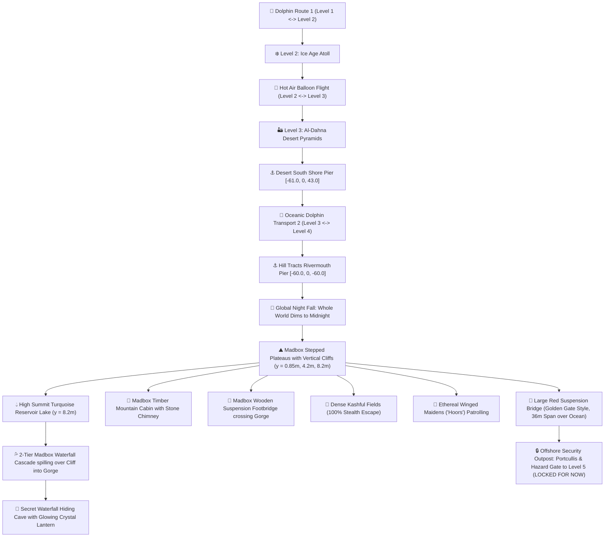

# Level 4: Mayabi Hill Tracts & Celestial Paradise (মায়াবী পাহাড়ী উপত্যকা — Madbox Edition) — Technical Plan & Architecture

> **Feature Goal:** Design and build **Level 4 (Mayabi Hill Tracts)** in the Lukao 3D archipelago according to the **Madbox stylized low-poly art style** (clean stepped plateaus with vertical warm sandstone drop cliffs, turquoise mountain reservoir lake, cascading cliff waterfall, winding river gorge, timber mountain lodge, and conic pine trees). Features a **Global Night Transition** upon landing on Level 4 (the entire archipelago transitions into midnight, daytime sun dims, and silver moonlight bathes the islands), a **Large Red Suspension Bridge (Golden Gate style)** spanning 36 meters across the open ocean towards Level 5 with an offshore security outpost and a locked gate ("gate off locked for now"), ethereal winged celestial maidens ("Hoors"), and dense tall escape grass (কাশফুল).  
> **Document Location:** `docs/level-4-hill-tracts-plan.md`  
> **Platform Target:** Cross-Platform (iOS / Android Hermes in Expo Go & WebGL).

---

## 1. Overview & Map Geography

Level 4 is situated in the **Southern ocean quadrant** centered at **`[-60, 0, -85]`** with an expansive **46m radius** footprint.

---

## 2. Madbox Visual Style & Landmarks

### 2.1. Madbox Stepped Plateaus & Cliffs
- **Clean Stepped Low-Poly Terraces:**
  - **Layer 1: Sandy Shore Shelf ($y = 0.2\text{m}$, $r = 43\text{m}$):** Golden sandy beach surrounding the island base.
  - **Layer 2: Main Verdant Plateau ($y = 0.85\text{m}$, $r = 39.5\text{m}$):** Lush green top surface with vertical drop sandstone cliff walls (`#d97706`).
  - **Layer 3: Mid Mountain Plateau ($y = 4.2\text{m}$, center `[-52, -91]`, $r = 18.5\text{m}$):** Elevated terrace holding the timber mountain lodge, conic pine groves, and the wooden rope bridge landing.
  - **Layer 4: High Summit Peak Plateau ($y = 8.2\text{m}$, center `[-66, -99]`, $r = 12.5\text{m}$):** Highest plateau cradling the turquoise mountain reservoir lake.
  - **Natural Stepped Stone Paths:** Terraced stone stairs allowing seamless walking between all plateau tiers.

### 2.2. Mountain Reservoir Lake, Waterfall & Secret Cave
- **High Mountain Reservoir Lake:** Flat crystal turquoise water surface perched at $y = 8.25\text{m}$ with gentle specular shimmer.
- **Madbox Cliff Waterfall Cascade:** Translucent animated sheet gushing from the reservoir edge over the sandstone cliff into the gorge plunge pool.
- **Secret Waterfall Cave:** Tucked directly behind the falling water sheet at $y = 0.4\text{m}$, equipped with a glowing cyan crystal lantern and complete cover from seekers.

### 2.3. Timber Mountain Cabin & Conic Pine Trees
- **Madbox Timber Lodge:** Cozy wooden cabin at `[-48, 4.2, -93]` with gabled dark brown roof, fieldstone chimney, front veranda, and glowing warm lantern.
- **Faceted Conic Pines:** 3-tiered faceted pine cones with staggered forest greens (`#166534`, `#15803d`, `#22c55e`).

### 2.4. Global Night Transition (`DynamicArchipelagoLighting`)
- When the player enters or lands at Level 4 (or rides the dolphin to Level 4), the **entire world turns to night**:
  - Sky horizon background smoothly transitions from daytime azure (`#7dd3fc`) to spooky deep midnight (`#030712`).
  - Daytime sun dims from `1.25` down to `0.02`.
  - Ambient illumination shifts from bright white to dark midnight indigo (`#1e1b4b`).
  - Directional silver moonlight (`#38bdf8`) activates overhead, casting cool silver glimmers onto the mountain waters and plateaus.
  - 48 glowing green/gold fireflies (`EerieFireflySwarm`) and 140 monsoon rain streaks dance across the atmosphere.
  - Overhead silver crescent moon torus shines in the night sky.

### 2.5. Large Red Suspension Bridge to Level 5 (Locked Gate)
- **Golden Gate Stylized Bridge:**
  - Starts at Level 4 West edge `[-76.0, 6.4, -85.0]` via an asphalt approach ramp from the main plateau.
  - Spans **36 meters** west over the open ocean to `[-112.0, 6.4, -85.0]`.
  - Twin red suspension towers at `x = -86.0` and `x = -102.0` rising to $y = 17.5\text{m}$, with parabolic suspension cables and aircraft warning beacons.
  - Full asphalt highway deck ($w = 4.4\text{m}$) with double yellow road stripes and red safety railings.
- **Offshore Security Gatehouse (Locked for Now):**
  - Concrete oceanic outpost at `x = -112.0`.
  - Heavy iron portcullis security gate with yellow/black hazard warning barricades and glowing red padlock beacon.
  - Kinematic boundary stop at `x = -111.4` preventing players from crossing into Level 5 ahead of schedule.

---

## 3. Technical Architecture & File Map

| File | Purpose |
| :--- | :--- |
| `src/components/game/hill-tracts-island.tsx` | Master Level 4 component: Madbox stepped plateaus, mountain lake, cliff waterfall, wooden rope bridge, timber cabin, and Large Red Suspension Bridge to Level 5. |
| `src/components/game/lukao-scene.tsx` | Houses `DynamicArchipelagoLighting` for reactive global day <-> night transitions when landing on Level 4. |
| `src/components/game/collision-system.ts` | Elevation mapping for Madbox plateaus ($y = 0.85\text{m}, 4.2\text{m}, 8.2\text{m}$), stone stairs, Large Red Bridge deck ($y = 6.4\text{m}$), and solid barrier stop at the locked Level 5 gate ($x = -111.4$). |
| `src/components/game/celestial-maidens.tsx` | Winged celestial maidens ("Hoors") with fluttering wings, glowing halos, and graceful patrol cycles. |
| `src/components/game/hill-tall-grass.tsx` | Instanced tall mountain pampas grass (কাশফুল) with wind sway for stealth escape. |
| `src/components/game/dolphin-system.tsx` | Oceanic transport Route 2 connecting Level 3 Desert Pier to Level 4 Hill Tracts Pier. |
| `src/components/game/game-engine-state.ts` | State machine updates for Level 4 dolphin ride and dynamic day-night climate timer. |
| `docs/level-4-hill-tracts-plan.md` | This architectural blueprint. |
| `docs/plan.md` | Master project roadmap update. |

---

## 4. Mobile 60 FPS Performance Strategy

1. **Procedural Geometry Primitives:** All hills, bridges, waterfalls, and maidens use lightweight Three.js primitives (Cylinders, Boxes, Lathes, and Extrusions) with shared materials—zero external `.glb` loading bottlenecks.
2. **Instanced Grass & Rain Particles:** Rain and tall grass use single-draw-call buffer geometries with GPU vertex offsets for realistic wind sway.
3. **Smooth Delta Capping:** All animation loops (`useFrame`) cap `delta` at 0.05s to prevent physics explosions on frame spikes.
4. **Optimized Lighting:** Ambient light color and intensity blend smoothly between day and night without expensive dynamic shadow re-allocations.

