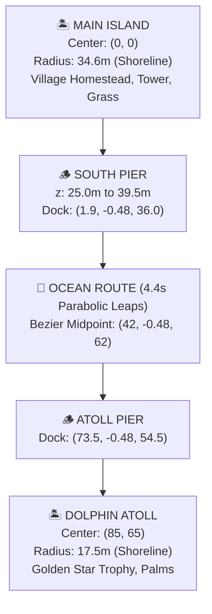
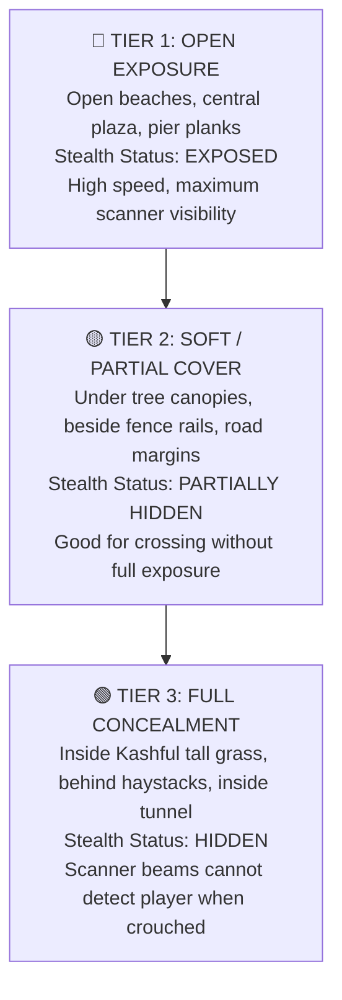

# Lukao 3D — Mobile World Design & Performance Limitations Guide

> **Target Audience:** Designers, 3D Artists, and Game Developers building islands, playgrounds, characters, and props in **Lukao**.  
> **Platform Target:** iOS & Android (Expo Go / React Native Hermes) & WebGL (Chrome / Safari / Firefox).  
> **Performance Target:** Rock-solid **60 FPS** on mid-range mobile devices with zero lag or stutter.

---

## 1. Core Architecture & Frame Pipeline

In Lukao, physics and character input run at 60–120 FPS decoupled from React render cycles. Understanding this pipeline prevents common performance bottlenecks:


### Why Mobile 3D Differs from PC / Console
1. **Unified Memory & Thermal Throttling:** Phones share CPU and GPU memory on a single battery-constrained SoC. When overloaded, the OS thermally throttles within 60 seconds, dropping the game from 60 FPS to 15 FPS.
2. **The JavaScript / Hermes Bridge:** Mutating individual object matrices in tight JavaScript loops inside `useFrame` saturates the React Native bridge.
3. **Tile-Based Deferred Rendering (TBDR):** Mobile GPUs divide the screen into small tiles. When dozens of overlapping transparent or double-sided polygons cover the camera view, **Fragment Overdraw** chokes the GPU fill-rate.

---

## 2. The 5 Golden Budgets for Mobile Playgrounds

| Metric | Safe Budget (🟢 60 FPS) | Danger Zone (🟡 30–45 FPS) | Critical Lag (🔴 < 20 FPS) |
| :--- | :--- | :--- | :--- |
| **Total Triangles on Screen** | **15,000 – 35,000** | 40,000 – 80,000 | > 100,000 |
| **Single Prop / Asset Triangles** | **50 – 500** | 1,000 – 3,000 | > 10,000 |
| **Total Draw Calls per Frame** | **30 – 65** | 70 – 120 | > 150 |
| **Dynamic Shadow Casters** | **0 – 3** (Actors only) | 4 – 10 | > 15 (Or entire trees) |
| **JS Object Updates per Frame** | **< 15 Groups** | 20 – 50 Groups | > 100 in `useFrame` |
| **Texture File Size** | **Procedural / < 512KB** | 1MB – 2MB | > 5MB (Uncompressed VRAM) |

---

## 3. Spatial World Layout & Island Coordinates

Lukao uses an archipelago coordinate system. Islands are spaced at calculated distances to maintain panoramic horizon beauty while avoiding draw-call congestion:



### Coordinate Reference Table
- **Main Island Center:** `[0, 0, 0]`, Walkable Shoreline: $r = 34.6$m.
- **Village Homestead:** `[-12, 0, 9]`.
- **East Meadow Grand Mango Tree:** `[15.5, 0, -2.5]`.
- **Seeker Observation Spire:** `[14, 0, -12]`.
- **Arch Bridge & Tunnel:** `[-2, 0, -13]`.
- **South Pier Walkway:** $x \in [-4.5, 4.5]$, $z \in [25.0, 39.5]$.
- **Dolphin Atoll Center:** `[85, 0, 65]`, Walkable Shoreline: $r = 17.5$m.

---

## 4. Case Studies: Real Bugs & Proven Architectural Fixes

### Case 1: The 130,000-Triangle Mango Tree Slowdown
- **Symptom:** Approaching the asset tree in Expo Go caused intense character lag and dropped frames down to ~18 FPS.
- **Root Cause Analysis:**
  1. The raw downloaded `.glb` model contained **130,451 triangles** (over 51,000 triangles on leaves alone).
  2. The material used `side: THREE.DoubleSide` with `castShadow = true`.
  3. When the camera got close to the tree, 50,000 overlapping leaf triangles filled 100% of the screen. The mobile GPU had to shade every pixel 20+ times (**Fragment Overdraw**).
- **The Solution:**
  - Replaced the heavy file with our own **custom procedural Mango Tree (<200 triangles)** using Three.js compound primitives.
  - Replaced dynamic shadow maps with a **1-polygon soft contact blob shadow** (`circleGeometry args={[2.9, 14]}`).
  - Result: Beautiful visual presence with locked 60 FPS on all Android devices.

---

### Case 2: The "Sticky / Slow Movement" After Ocean Crossing
- **Symptom:** After riding the dolphin back to the main island, movement felt sluggish, stuck, or slow on the beach.
- **Root Cause Analysis:**
  1. In `collision-system.ts`, the main island boundary was clamped to `arenaRadius = 31.0m`.
  2. The wooden pier and shoreline sand shelf extend out to **$z = 35.5m$** ($r = 35.5m$).
  3. When dismounting at `z = 35.5m` and stepping off the narrow pier, the physics engine saw `distance (35.5m) > arenaRadius (31.0m)`.
  4. Every single frame, the boundary clamp **dragged the character backwards** towards $31.0m$, directly fighting the joystick movement vector!
- **The Solution:**
  - Expanded `this.arenaRadius` from `31.0m` to **`34.6m`** (the true beach waterline).
  - Widened the south pier corridor to $x \in [-4.5, 4.5]$ and $z \in [25.0, 39.5]$.
  - Result: Character runs smoothly off the pier onto the sand with zero drag or stickiness.

---

### Case 3: The Slower Sea Crossing (Delta Time Clamping)
- **Symptom:** Crossing from Dolphin Atoll back to the main island took significantly longer than going to the atoll.
- **Root Cause Analysis:**
  - Time step `dt` in `dolphin-system.tsx` was clamped to `0.033s` (30 FPS cap).
  - Facing the main island rendered more world objects than facing the open sea, causing a minor frame dip.
  - Because `dt` was clamped at `0.033s`, the game clock itself slowed down, stretching a 4.4-second journey to 7 seconds!
- **The Solution:**
  - Expanded `dt` clamp to `Math.min(safeDelta, 0.08)`.
  - The journey now advances in real 1:1 wall-clock time regardless of temporary frame dips.

---

## 5. Architectural Rules for Designing Future Playgrounds

### Rule 1: The "Art of Compound Primitives" (Madbox Style)
Lukao's playful visual aesthetic is inspired by diorama cartoon games (*Brawl Stars*, *Crossy Road*, *Animal Crossing*).
- **Prefer Three.js primitives:** Spheres, cylinders, boxes, cones, and dodecahedrons with `flatShading: true`.
- Compound primitives load in **0 ms**, use **0 KB disk space**, and run at **rock-solid 60 FPS**.
- An authentic village house or mango tree can be sculpted with 15–20 compound shapes (<250 polygons) instead of a 10MB raw CAD mesh.

### Rule 2: Contact Shadow Blobs vs Dynamic Shadow Maps
- **Never enable `castShadow` on foliage, trees, grass, or small clutter.**
- Instead, place a flat circular mesh beneath props and trees:
  ```tsx
  <mesh position={[0, 0.02, 0]} rotation={[-Math.PI / 2, 0, 0]}>
    <circleGeometry args={[radius, 14]} />
    <meshBasicMaterial color="#064e3b" transparent opacity={0.35} />
  </mesh>
  ```
- **Why?** It costs **1 polygon**, produces a soft, cartoon-style contact shadow, and eliminates thousands of GPU shadow passes per frame.

### Rule 3: Animate the Parent Group in `useFrame`
When animating wind, water, or foliage:
- **BAD (Chokes JS Bridge):**
  ```ts
  // 120 child blades * 60 frames = 7,200 matrix updates per second!
  blades.forEach((b, i) => {
    meshRefs.current[i].rotation.z = Math.sin(time + b.phase);
  });
  ```
- **GOOD (Smooth & Lightweight):**
  ```ts
  // 1 single group update per patch!
  groupRef.current.rotation.z = Math.sin(time * 2.2 + patchOffset) * 0.05;
  ```

### Rule 4: Shoreline & Boundary Margin Buffers
Whenever building a new island, bridge, or pier:
1. **Match Visual Shoreline to Collision Radius:**
   - If visual beach foam ends at $r = 35.0$m, set `arenaRadius = 34.6$m to $34.8$m.
2. **Generous Walkway Corridors:**
   - Never restrict a pier corridor to the exact plank width. Give a $\pm 4.5$m buffer so players running diagonally never hit invisible boundary drag.
3. **Safe Dismount Points:**
   - Always place dismount spawn points safely inside the walkable deck surface, well clear of water or outer radius clamps.

### Rule 5: Viewport Sizing in Expo GLView (`@react-three/fiber/native`)
- In Expo's native `GLView`, the native Android/iOS surface framebuffer is directly coupled to the native window dimensions.
- **Never call `gl.setPixelRatio()` manually inside `onCreated` in React Native:** Doing so shrinks Three.js's `gl.viewport()` to a fraction (e.g. $1.5 / 3.0 = 50\%$) of the native SurfaceView, causing the 3D scene to draw in only half the screen!
- Let `@react-three/fiber/native` manage the full-screen viewport automatically, and use polygon/shadow/Early-Z optimizations to keep GPU workload light.

---

## 6. Hide & Seek Level Design: The 3-Tier Stealth Rule

To keep gameplay engaging, every island and zone should follow the **3-Tier Stealth Architecture**:



---

## 7. Step-by-Step Checklist for Adding a New Island or Zone

Before adding any new island, landmark, or animal into Lukao, run through this 5-step checklist:

- [ ] **Step 1: Polygon Audit**
  - Is the model or component under 1,500 triangles?
  - If using an imported model, has it been inspected in Three.js / Blender to confirm low poly count?

- [ ] **Step 2: Material & Overdraw Check**
  - Are leaves and fences using `side: THREE.FrontSide` rather than `THREE.DoubleSide`?
  - Are materials reusing shared standard palette colors (`#22c55e`, `#78350f`, `#b45309`)?

- [ ] **Step 3: Shadow Evaluation**
  - Is `castShadow` disabled on large complex geometry?
  - Is a soft contact shadow blob used at the base?

- [ ] **Step 4: Collision World Alignment**
  - Are cylinder/box colliders registered in `collision-system.ts`?
  - Does the island's boundary radius allow players to explore the beaches without getting pulled backwards?

- [ ] **Step 5: Mobile Verification (Expo Go)**
  - Test moving the player right up to the object on an Android phone.
  - Verify that running, turning the camera, and walking away remains at a locked, buttery 60 FPS.

---

*This guide is maintained under `docs/world-design-and-performance-guide.md` and should be consulted whenever architecting new zones for Lukao.*
